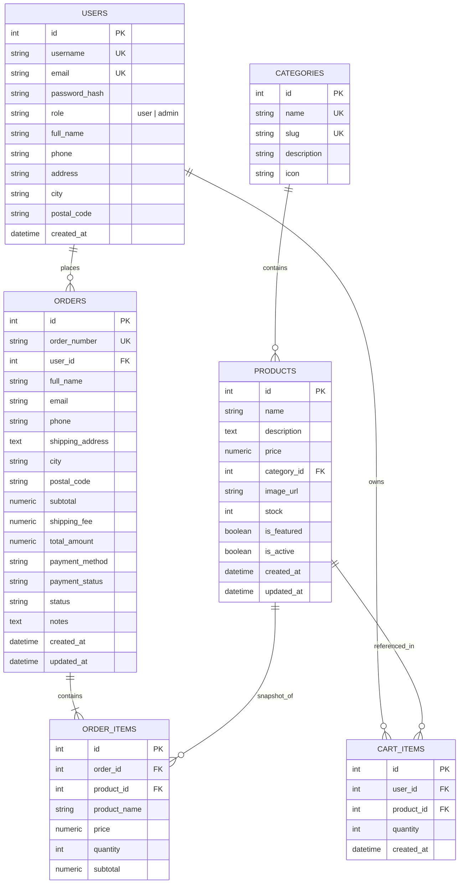

# ShopFlow - E-Commerce Web Application

[](https://www.python.org/)
[](https://flask.palletsprojects.com/)
[](https://getbootstrap.com/)
[](https://www.sqlalchemy.org/)
[-brightgreen.svg)]()

> **B.Tech Computer Science & Engineering Final Assignment / Capstone Project**  
> A complete, modern, full-stack E-Commerce web application developed using **Python Flask**, **Flask-SQLAlchemy**, **Flask-Login**, **Flask-WTF**, **Bootstrap 5**, and **SQLite / PostgreSQL**.

---

## Table of Contents
1. [Project Overview](#1-project-overview)
2. [Key Features](#2-key-features)
3. [Technology Stack](#3-technology-stack)
4. [Database Architecture & Schema](#4-database-architecture--schema)
5. [User Interface & Design Preview](#5-user-interface--design-preview)
6. [Windows PowerShell Setup Guide](#6-windows-powershell-setup-guide)
7. [Default Accounts & Initial Admin Setup](#7-default-accounts--initial-admin-setup)
8. [Running the Application](#8-running-the-application)
9. [Running the Test Suite](#9-running-the-test-suite)
10. [RESTful API Documentation](#10-restful-api-documentation)
11. [Google Maps Platform Integration](#11-google-maps-platform-integration)
12. [Deployment Guide (Render / PostgreSQL)](#12-deployment-guide-render--postgresql)
13. [Known Limitations & Future Scope](#13-known-limitations--future-scope)
14. [License & Academic Attribution](#14-license--academic-attribution)

---

## 1. Project Overview

**ShopFlow** is a fully functional online shopping web application built from the ground up for academic evaluation, code demonstration, and portfolio presentation. It covers the full lifecycle of an e-commerce platform:

- **Storefront & Discovery:** Customers browse products across categories, search keywords, filter by availability, and inspect product details with high-resolution imagery and stock badges.
- **Cart & Order Processing:** Real-time quantity adjustment, stock limit enforcement, server-calculated totals, and database transactions for inventory deduction.
- **Order Lifecycle & Tracking:** Customers track `Order Placed` &rarr; `Confirmed` &rarr; `Shipped` &rarr; `Delivered`, with timestamped status history and eligible-order cancellation.
- **Administrative Operations:** A protected admin dashboard provides high-level business analytics (revenue, order counts, stock alerts), full product catalog CRUD, and status dispatch control.
- **RESTful Backend APIs:** Standardized JSON endpoints for headless or programmatic integration.

---

## 2. Key Features

### User & Authentication
- **Secure Authentication:** Password hashing using Werkzeug's `pbkdf2:sha256` salted hashes.
- **Role-Based Access Control (RBAC):** Distinct `User` and `Admin` permissions. Protected routes reject unauthorized requests with HTTP `403 Forbidden`.
- **Session Management:** Secure cookie sessions managed by `Flask-Login` with `HttpOnly` and `SameSite` flags.
- **1-Click Demo Fill:** Fast-fill buttons on the login screen for rapid viva evaluations.
- **Customer Profiles:** Manage contact numbers and default shipping addresses.

### Product Catalog
- **Multi-Category Browsing:** Curated categories (Electronics, Fashion & Apparel, Home & Living, Books & Stationery).
- **Search & Sort:** Instant query filtering by name and description, with sorting by price and arrival date.
- **Stock Badging:** Real-time visual stock indicators (`In Stock`, `Low Stock (<= 5)`, `Out of Stock`).
- **Resilient Media:** Built-in SVG fallback placeholders ensure zero broken product images.

### Shopping Cart & Checkout
- **Interactive Cart:** AJAX-powered quantity increment/decrement, line item subtotals, and live navbar badges without full page reloads.
- **Server-Side Financial Security:** All item prices, subtotal, shipping fee, and grand total calculations happen on the server—never trusting client-submitted prices.
- **Atomic Database Transactions:** Order placement wraps order creation, item snapshots, inventory decrements, and cart clearing inside `db.session.commit()` with automatic rollback on error.
- **Payment Safety:** COD and demo card selections are recorded as pending; the app does not claim a payment was collected without a real payment confirmation integration.

### Google Maps Delivery Location
- **Checkout Interactive Pin Selection:** Customers can pinpoint their exact delivery doorstep on an interactive Google Map with marker drag & click listeners.
- **HTML5 Geolocation ("Detect My Location"):** One-click GPS device location retrieval to instantly center the delivery pin.
- **Geocoding & Address Synchronization:** "Pin My Address" matches typed street addresses to map coordinates.
- **Order Tracking Destination Display:** Customer order details page displays the confirmed delivery destination pin, GPS coordinates, and an "Open Destination in Google Maps" external link.
- **Admin Delivery Verification:** Administrators inspect confirmed delivery coordinates and destination map pins when processing orders.
- **Server-Side Coordinate Validation:** Strict bounds checking (-90° to +90° latitude, -180° to +180° longitude) prevents invalid or spoofed coordinates.
- **Graceful Offline Fallback:** If the API key is unconfigured or blocked by quota/billing, the checkout and tracking systems seamlessly transition to address-based preview mode with manual coordinate inputs, ensuring zero disruption.
- **Accurate Academic Disclosure:** Clearly notes that the map visualizes customer delivery destinations and does not claim real-time fleet courier telemetry without live vehicle GPS hardware.

### Order Tracking
- **Interactive Visual Timeline:** Responsive tracking stepper (`Order Placed` &rarr; `Confirmed` &rarr; `Shipped` &rarr; `Delivered`), last update, and estimated delivery.
- **Customer Order History:** Owner-scoped status/date filters and pagination.
- **User Order Isolation:** Strict server-side validation ensures customers can only access their own order receipts.
- **Cancellation & Inventory Restoration:** Customers and admins can cancel only eligible orders; transactional status checks prevent repeated stock restoration. Refunds remain pending until confirmed by an integrated refund provider.
- **PDF Invoices:** Owner-authorized downloadable PDF invoices use saved order item and address snapshots.

### Administrator Control Panel
- **Executive Analytics:** Real-time metrics for Total Revenue, Total Orders, Active Catalog Items, and Low Stock Alerts.
- **Product Management:** Add, edit, restock, or soft-delete products.
- **Order Dispatch:** Search and filter orders, follow sequential status transitions, record tracking/courier details, cancellation reasons, and inspect timestamped history.
- **Customer Directory:** View registered user accounts and their order frequency.

---

## 3. Technology Stack

| Layer | Technologies |
| :--- | :--- |
| **Frontend** | HTML5, CSS3, JavaScript (ES6+), Bootstrap 5.3.3, Bootstrap Icons 1.11.3 |
| **Backend** | Python 3.10+ / 3.13, Flask 3.1.3 (Application Factory & Blueprints) |
| **ORM & Database** | Flask-SQLAlchemy 3.1.1 (Supports SQLite locally & PostgreSQL in production) |
| **Authentication** | Flask-Login 0.6.3, Werkzeug Security (Salted PBKDF2:SHA256) |
| **Form Protection** | Flask-WTF 1.3.0 (CSRF Protection for forms and AJAX headers) |
| **Configuration** | Python-Dotenv (Environment variable configuration via `.env`) |
| **Testing** | Pytest 9.1.1 with shared SQLite in-memory test fixtures |

---

## 4. Database Architecture & Schema

The application employs relational database modeling with foreign keys, cascaded relationships, and `Numeric(10, 2)` monetary representations:



---

## 5. User Interface & Design Preview

> **Screenshots Guide for Assignment Submission:**  
> To include live screenshots in your project report, take screenshots of your local running instance and save them to `docs/screenshots/`:
> 1. `homepage.png` - Hero banner, categories, and featured products.
> 2. `product_detail.png` - Image, stock badges, specifications, and Add to Cart form.
> 3. `cart_page.png` - Line items, interactive quantity controls, and summary breakdown.
> 4. `checkout_page.png` - Shipping form, simulated payment selector, and total calculation.
> 5. `order_tracking.png` - 4-step visual stepper and receipt breakdown.
> 6. `admin_dashboard.png` - Revenue analytics, stock warning counters, and dispatch management.

---

## 6. Windows PowerShell Setup Guide

Follow these exact steps in **Windows PowerShell** or **VS Code Terminal**:

### Step 1: Open Project Directory
```powershell
cd "c:\Users\ashir\OneDrive\Desktop\E-Commerce Web Application"
```

### Step 2: Create Python Virtual Environment
```powershell
py -3 -m venv venv
```

### Step 3: Enable Script Execution & Activate Environment
If running scripts is restricted on your machine, temporarily permit them for the current process:
```powershell
Set-ExecutionPolicy -ExecutionPolicy RemoteSigned -Scope Process
.\venv\Scripts\Activate.ps1
```
*(Your terminal prompt will now show `(venv)` at the beginning).*

### Step 4: Install Dependencies
```powershell
pip install -r requirements.txt
```

### Step 5: Configure Environment Variables
Copy `.env.example` to `.env` (a ready-to-run `.env` is already pre-generated):
```powershell
Copy-Item .env.example .env -Force
```

---

## 7. Default Accounts & Initial Admin Setup

The project includes a database seeder with ready-to-use accounts for immediate testing:

| Role | Username / Email | Password | Permissions |
| :--- | :--- | :--- | :--- |
| **Administrator** | `admin@shop.com` (or `admin`) | `admin123` | Full Admin Panel, Product CRUD, Order Status Updates |
| **Customer** | `user@shop.com` (or `john_doe`) | `user123` | Storefront browsing, Cart, Checkout, Order Tracking |

### To Seed the Database:
Populate 12 rich sample products across 4 categories and the initial demo accounts:
```powershell
python seed.py
```
*(Alternatively, you can use the Flask CLI: `flask seed-db`).*

### Upgrade an Existing Database for Order Tracking
After installing dependencies and configuring `DATABASE_URL`, run the schema upgrade before starting the application. This command adds missing order tracking fields and history without replacing existing tables or order data:
```powershell
flask --app app upgrade-order-tracking
```
The command is safe to rerun. For a fresh install with no application tables, run `flask --app app init-db` first, then run the upgrade command.

For local development, `DATABASE_URL=sqlite:///ecommerce.db` resolves explicitly to `instance\ecommerce.db`. Use this same path when inspecting or backing up the application database; a separate project-root `ecommerce.db` file is not the active database.

Optional invoice business details can be configured in `.env`:
```dotenv
STORE_NAME=ShopFlow
STORE_ADDRESS=
STORE_EMAIL=
STORE_PHONE=
```
The invoice does not include tax/GST because no tax rate or registration configuration exists in this project.

### To Create a Custom Administrator Securely via CLI:
```powershell
flask create-admin --username myadmin --email admin2@shop.com --password mysecurepassword
```

---

## 8. Running the Application

Start the local Flask development server:
```powershell
python app.py
```
Or via the Flask CLI:
```powershell
flask run --port=5000 --debug
```

Open your browser and visit:
👉 **`http://127.0.0.1:5000`**

---

## 9. Running the Test Suite

The project includes an automated unit and integration test suite covering authorization, cart operations, transactional stock deductions, Google Maps delivery location selection, coordinate validation, order isolation, order status transitions, cancellation inventory safety, invoice access, and REST APIs.

Run tests with verbose reporting:
```powershell
.\venv\Scripts\python.exe -m pytest -v
```

### Test Coverage Highlights:
- `tests/test_auth.py`: Registration, duplicate checks, password constraints, login, logout.
- `tests/test_products.py`: Browsing, keyword search, category filter, admin-only CRUD, 403 access control.
- `tests/test_cart.py`: Add items, stock limits validation, quantity adjustment, line subtotals.
- `tests/test_checkout.py`: Atomic checkout transaction, inventory decrement, empty cart rejection, stock validation, delivery pin coordinates saving (`latitude`, `longitude`), coordinate bounds validation (-90° to 90° lat, -180° to 180° lng), and address-only fallback mode.
- `tests/test_orders.py`: User order isolation (cannot access others' receipts), delivery coordinates and destination map inspection, cancellation inventory restoration, admin status transitions.
- `tests/test_api.py`: RESTful JSON responses, status codes (200, 201, 400, 401, 403, 404), coordinate payload validation, and Google Maps URL serialization.

### Manual Order Tracking Workflow
1. Sign in as a customer, add an in-stock product to the cart, and complete checkout. The order starts at **Order Placed** with payment **Pending**.
2. Open **My Orders** and view the order details, timeline, saved address, totals, and estimated delivery date.
3. Sign in as an administrator and open **Admin Panel → Orders**. Update the order through **Confirmed**, **Shipped**, then **Delivered** in sequence. Tracking number and courier details can be recorded when shipping.
4. Return to the customer account and refresh the order details to see the timestamped status history. Download the order's PDF invoice.
5. To verify cancellation, place a separate order and cancel it while it is **Order Placed** or **Confirmed**. A shipped/delivered order cannot be cancelled; a second cancellation cannot restore its stock again.
6. Automated tests also verify that another customer's account cannot view or download that order's invoice, and that unauthorized status updates are rejected.

---

## 10. RESTful API Documentation

ShopFlow exposes clean, standardized REST APIs under the `/api/` prefix.

Cookie-authenticated POST/PUT/DELETE requests use Flask-WTF CSRF protection. Include the `csrf_token` value from a rendered page's `<meta name="csrf-token">` in the `X-CSRFToken` request header; do not disable CSRF for API routes.

### Summary Table

| Method | Endpoint | Access Level | Description |
| :--- | :--- | :--- | :--- |
| `GET` | `/api/products` | Public | List products (supports `?search=`, `?category=`, `?sort=`) |
| `GET` | `/api/products/<id>` | Public | Get product details by ID |
| `POST` | `/api/products` | Admin Only | Create a new product |
| `PUT` | `/api/products/<id>` | Admin Only | Update an existing product |
| `DELETE` | `/api/products/<id>` | Admin Only | Delete or deactivate product |
| `GET` | `/api/cart` | Authenticated | Retrieve current user's cart |
| `POST` | `/api/cart/add` | Authenticated | Add product to cart |
| `PUT` | `/api/cart/update` | Authenticated | Update item quantity in cart |
| `DELETE` | `/api/cart/remove/<item_id>` | Authenticated | Remove item from cart |
| `POST` | `/api/checkout` | Authenticated | Place order from cart items |
| `GET` | `/api/orders` | Authenticated | Retrieve user's order history |
| `GET` | `/api/orders/<id>` | Owner / Admin | Retrieve single order details |
| `GET` | `/api/admin/orders` | Admin Only | List all orders with `?status=` filter |
| `PUT` | `/api/admin/orders/<id>/status` | Admin Only | Update order status |

---

### Example API Requests & Responses

#### 1. List Products
- **Request:**
  ```http
  GET /api/products?category=electronics&sort=price_asc HTTP/1.1
  Host: 127.0.0.1:5000
  ```
- **Response (`200 OK`):**
  ```json
  {
    "success": true,
    "count": 4,
    "products": [
      {
        "id": 4,
        "name": "AeroMechanical RGB Mechanical Keyboard",
        "category_id": 1,
        "category_name": "Electronics",
        "price": 69.99,
        "stock": 18,
        "in_stock": true,
        "is_featured": false,
        "image_url": "https://images.unsplash.com/photo-1587829741301-dc798b83add3?w=800&auto=format&fit=crop&q=80"
      }
    ]
  }
  ```

#### 2. Create Product (Admin Only)
- **Request:**
  ```http
  POST /api/products HTTP/1.1
  Host: 127.0.0.1:5000
  Content-Type: application/json
  
  {
    "name": "UltraWide Gaming Monitor 34-inch",
    "description": "Curved 144Hz 1ms HDR display.",
    "price": 449.99,
    "category_id": 1,
    "stock": 10,
    "is_featured": true
  }
  ```
- **Response (`201 Created`):**
  ```json
  {
    "success": true,
    "message": "Product created successfully",
    "product": {
      "id": 13,
      "name": "UltraWide Gaming Monitor 34-inch",
      "price": 449.99,
      "stock": 10,
      "in_stock": true
    }
  }
  ```

#### 3. Add Item to Cart
- **Request:**
  ```http
  POST /api/cart/add HTTP/1.1
  Host: 127.0.0.1:5000
  Content-Type: application/json

  {
    "product_id": 1,
    "quantity": 2
  }
  ```
- **Response (`200 OK`):**
  ```json
  {
    "success": true,
    "message": "\"SoundPro Wireless Noise-Cancelling Headphones\" added to cart",
    "cart_count": 2,
    "grand_total": 299.98
  }
  ```

#### 4. Place Order (Checkout)
- **Request:**
  ```http
  POST /api/checkout HTTP/1.1
  Host: 127.0.0.1:5000
  Content-Type: application/json

  {
    "full_name": "John Doe",
    "email": "user@shop.com",
    "phone": "+1-555-019-2834",
    "shipping_address": "452 Campus Avenue, Apt 3B",
    "city": "Metro City",
    "postal_code": "94016",
    "payment_method": "Cash on Delivery",
    "latitude": 37.7749,
    "longitude": -122.4194,
    "notes": "Leave at front desk"
  }
  ```
- **Response (`201 Created`):**
  ```json
  {
    "success": true,
    "message": "Order placed successfully",
    "order": {
      "id": 1,
      "order_number": "ORD-20261026-9E4B21",
      "customer_name": "John Doe",
      "status": "Order Placed",
      "subtotal": 299.98,
      "shipping_fee": 0.0,
      "total_amount": 299.98,
      "latitude": 37.7749,
      "longitude": -122.4194,
      "has_coordinates": true,
      "google_maps_url": "https://www.google.com/maps/search/?api=1&query=37.7749%2C-122.4194"
    }
  }
  ```

#### 5. Update Order Status (Admin Only)
- **Request:**
  ```http
  PUT /api/admin/orders/1/status HTTP/1.1
  Host: 127.0.0.1:5000
  Content-Type: application/json

  {
    "status": "Confirmed"
  }
  ```
- **Response (`200 OK`):**
  ```json
  {
    "success": true,
    "message": "Order status updated to Confirmed",
    "order": {
      "id": 1,
      "order_number": "ORD-20261026-9E4B21",
      "status": "Confirmed"
    }
  }
  ```
  Statuses must progress in order (`Order Placed` → `Confirmed` → `Shipped` → `Delivered`). Send `Shipped` in a second request after confirmation.

---

## 11. Google Maps Platform Integration

ShopFlow integrates **Google Maps Platform** to provide delivery location selection, GPS coordinate capture, and destination tracking.

### Architecture & Capabilities
1. **Interactive Checkout Map:**
   - Customers can adjust their exact doorstep location by clicking anywhere on the map or dragging the pin.
   - **HTML5 Geolocation (`Detect My Location`):** Detects customer coordinates using browser GPS APIs and snaps the map to their current location.
   - **Geocoding (`Pin My Address`):** Converts the typed street address into geographic coordinates using Google Maps Geocoding service.
   - **Confirmation Badge:** Displays the confirmed latitude and longitude with visual feedback.
2. **Order Destination Tracking:**
   - Saved orders display an embedded destination map pin pointing to the customer-selected location.
   - **"Open Destination in Google Maps" Button:** Launches an external Google Maps search query using exact coordinates (`lat,lng`) or formatted address.
   - **Academic Honesty Disclosure:** Clearly states: *"Destination Map: Pinpoints customer-confirmed delivery doorstep. Real-time courier tracking is not simulated without live fleet GPS hardware."*
3. **Admin Verification & Customer Privacy:**
   - Administrators can review the delivery pin and GPS coordinates on `/admin/orders/<id>`.
   - Normal users are strictly blocked with HTTP `403 Forbidden` from accessing any other customer's order receipt or location data.
4. **Resilient Offline / Fallback Mode:**
   - If `GOOGLE_MAPS_API_KEY` is not provided, or if billing / authentication fails (`window.gm_authFailure`), the map automatically switches to a clean fallback card.
   - The customer can still preview their typed address on Google Maps or enter manual GPS coordinates.
   - The application never crashes and checkout remains 100% functional.

### Google Cloud Platform Setup & API Keys

To enable live interactive Google Maps rendering:

#### Step 1: Create a Google Cloud Project
1. Visit the [Google Cloud Console](https://console.cloud.google.com/).
2. Create a new project (e.g. `shopflow-ecommerce`).

#### Step 2: Enable Required APIs
Navigate to **APIs & Services &rarr; Library** and enable:
- **Maps JavaScript API** (renders the interactive map, pins, and controls)
- **Geocoding API** (converts typed addresses into GPS latitude & longitude)

#### Step 3: Create and Restrict an API Key
1. Go to **APIs & Services &rarr; Credentials &rarr; Create Credentials &rarr; API Key**.
2. **Set Application Restrictions (Recommended for Security):**
   - Choose **Websites** (HTTP referrers).
   - Add your local and production domains:
     - `http://127.0.0.1:5000/*`
     - `http://localhost:5000/*`
     - `https://your-production-app.onrender.com/*`
3. **Set API Restrictions:**
   - Restrict the key specifically to **Maps JavaScript API** and **Geocoding API**.

#### Step 4: Add API Key to `.env`
Open your `.env` file and set the key:
```env
GOOGLE_MAPS_API_KEY=AIzaSyYourActualGoogleMapsApiKeyHere
```
Restart your Flask server:
```powershell
python app.py
```

#### Step 5: Billing & Free Usage Notice
Google Cloud Platform provides a **$200 recurring free monthly credit** for Google Maps Platform, which covers thousands of map loads and address lookups. If billing is not enabled or quota is reached, ShopFlow's automatic fallback mode guarantees that the application runs smoothly without errors.

---

## 12. Deployment Guide (Render / PostgreSQL)

ShopFlow is production-ready and configured to deploy seamlessly to cloud hosting platforms like **Render**, **Railway**, or **Heroku**.

### Step 1: Create a PostgreSQL Database on Render
1. Log in to [Render](https://render.com/) and click **New + &rarr; PostgreSQL**.
2. Name the database (e.g., `shopflow-db`).
3. Copy the **Internal Database URL** or **External Database URL**.

### Step 2: Create a Web Service
1. Click **New + &rarr; Web Service** and connect your GitHub repository.
2. Select runtime: **Python 3**.
3. **Build Command:**
   ```bash
   pip install -r requirements.txt && flask --app app upgrade-order-tracking && python seed.py
   ```
4. **Start Command:**
   ```bash
   gunicorn app:app
   ```

### Step 3: Configure Environment Variables
Under the service's **Environment** tab, set:
- `FLASK_ENV` = `production`
- `SECRET_KEY` = `(generate a strong 64-character random string)`
- `DATABASE_URL` = `(paste your PostgreSQL connection string)`
  *(Note: ShopFlow automatically converts legacy `postgres://` URLs to `postgresql://`)*.
- `ADMIN_USERNAME` = `admin`
- `ADMIN_EMAIL` = `admin@yourdomain.com`
- `ADMIN_PASSWORD` = `(your strong admin password)`

Click **Deploy**! Render will build dependencies, seed categories and products into PostgreSQL, and launch the live application.

---

## 13. Known Limitations & Future Scope

In the spirit of honest academic engineering, here are the project's current boundaries:

1. **Payment and Refund Providers:** Payment choices are demonstration-only and remain pending; real payment/refund collection requires an integrated provider and verified webhook/confirmation flow.
2. **Product Imagery:** The application uses curated high-resolution HTTPS Unsplash images and local SVG vector fallbacks. A future production iteration can integrate Amazon S3 or Cloudinary for direct multi-file image uploads.
3. **Role Granularity:** The authorization architecture uses two roles (`Admin` and `User`). Expanding to multiple roles (e.g., `Inventory Manager`, `Support Agent`, `Vendor`) would be a natural next step.
4. **Email Notifications:** Receipts and status changes are displayed inside the application. Integrating an SMTP/SendGrid service would allow automated email notifications.

---

## 14. License & Academic Attribution
Developed for B.Tech Computer Science & Engineering assignment evaluation. Open for learning, educational demonstration, and modification.
